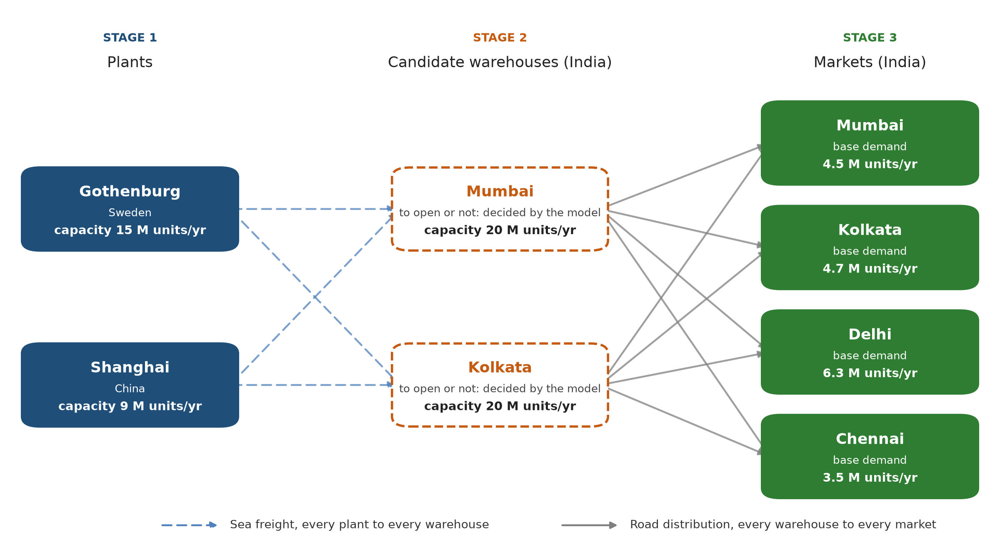
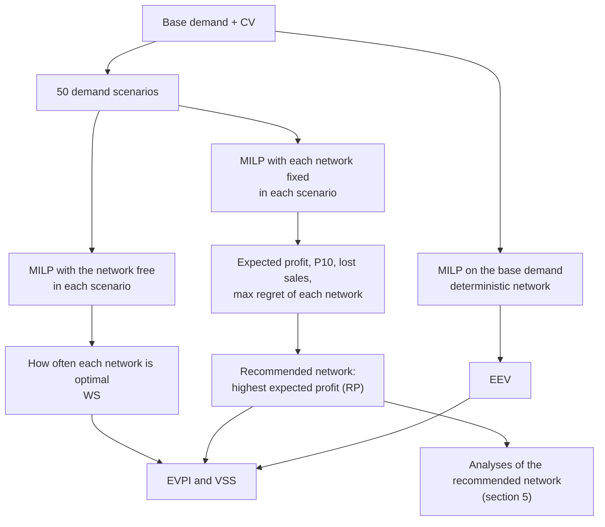

# Supply Chain Network Design: Simulation and Optimization of a 3-Stage Network

**MILP + Monte Carlo: choosing which warehouses to open in India for plants in Sweden and China**

[](https://github.com/giuseppegelarda/Supply_Chain_Network_Design_1/actions/workflows/tests.yml)

Two plants, in Gothenburg (Sweden) and Shanghai (China), supply four markets in India (Mumbai, Kolkata, Delhi and Chennai) through regional warehouses. A warehouse can be opened in Mumbai, in Kolkata or in both. The future demand is uncertain: which warehouses should be opened, and how should the plants supply them?

The project answers with two tools:

- a **mixed-integer linear program (MILP)** that, for a given demand, chooses the warehouses to open and the flows that maximize the annual profit: revenue minus production, transport, warehouse and CO2 costs, with lost sales when the capacity runs short;
- a **Monte Carlo simulation** over 50 demand scenarios, in which every possible network is kept fixed and evaluated on all of them: the recommended network is the one with the highest expected profit.

Further analyses then test how robust the recommendation is: sensitivity to prices and costs, planning horizon, warehouse capacity, demand variability and the cost–CO2 trade-off.

The recommended network, how robust it is and what drives it are discussed in **[RESULTS.md](RESULTS.md)**.

**Quick links:** [Results](RESULTS.md) · [Input data](#2-input-data) · [Model](#3-optimization-model-milp) · [Simulation](#4-demand-uncertainty-monte-carlo-simulation) · [Code](#7-project-structure) · [Outputs](#11-output-files)

Built with Python, PuLP and the HiGHS solver. The network structure and part of the data are inspired by a university course case study, extended here with new data, a selling price and the profit-maximization formulation.

## 1. The network

<p align="center"></p>

The model decides which of the two candidate warehouses to open (dashed boxes) and all the flows: how much each plant produces and ships to each warehouse, and how much each warehouse delivers to each market.

## 2. Input data

All inputs are Excel files in [`DATA/`](DATA); monetary values are in EUR, quantities per year.

| Item | Value | Input file |
|---|---|---|
| Base demand | Mumbai 4.5 M, Kolkata 4.7 M, Delhi 6.3 M, Chennai 3.5 M units/year (19.0 M in total) | [`DEMAND.xlsx`](DATA/DEMAND.xlsx) |
| Demand uncertainty | 50 scenarios; normal demand per market around the base, coefficient of variation 0.2; fixed random seed | settings ([`main.py`](main.py)) |
| Selling price | 3.50 EUR/unit in every market | [`SELLING_PRICE.xlsx`](DATA/SELLING_PRICE.xlsx) |
| Plant capacity | Gothenburg 15 M, Shanghai 9 M units/year (24 M in total) | [`CAP_PL.xlsx`](DATA/CAP_PL.xlsx) |
| Warehouse capacity | 20 M units/year each | [`CAP_WH.xlsx`](DATA/CAP_WH.xlsx) |
| Production cost | 2.00 EUR/unit in both plants | [`VARIABLE_PL_COST.xlsx`](DATA/VARIABLE_PL_COST.xlsx) |
| Sea freight, plant → warehouse | 0.035–0.080 EUR/unit | [`FREIGHT_COST.xlsx`](DATA/FREIGHT_COST.xlsx) |
| Road distribution, warehouse → market | 0.01 EUR/unit within the same city, 0.11–0.16 EUR/unit to the other cities | [`FREIGHT_COST_WH_MKT.xlsx`](DATA/FREIGHT_COST_WH_MKT.xlsx) |
| Warehouse cost | CAPEX 2 M EUR, recovered over 10 years at an 8% real rate (298,059 EUR/year), plus OPEX 450,000 EUR/year: 748,059 EUR/year per open warehouse | [`FIX_COST.xlsx`](DATA/FIX_COST.xlsx), [`OPEX.xlsx`](DATA/OPEX.xlsx) |
| Shipment size | Gothenburg 190,000, Shanghai 250,000 units per shipment, on every route | [`SIZE_CONTAINERS.xlsx`](DATA/SIZE_CONTAINERS.xlsx) |
| Holding cost rate | 18% a year of the production cost of the stock | [`HOLDING_PERCENTUAL.xlsx`](DATA/HOLDING_PERCENTUAL.xlsx) |
| Production CO2 | Gothenburg 16 g/unit, Shanghai 286 g/unit | [`EMI_FACTOR_PRODUCTION.xlsx`](DATA/EMI_FACTOR_PRODUCTION.xlsx) |
| Sea freight CO2 | 0.006 kg CO2 per ton·km | [`EMI_FACTOR_PL_WH.xlsx`](DATA/EMI_FACTOR_PL_WH.xlsx) |
| Sea distance, plant → warehouse | 6,254–13,530 km | [`DISTANCES_PL_WH.xlsx`](DATA/DISTANCES_PL_WH.xlsx) |
| Unit weight | 300 g | [`UNIT_WEIGHT.xlsx`](DATA/UNIT_WEIGHT.xlsx) |
| Storage CO2 | 11 g/unit in both warehouses | [`EMI_FACTOR_STORAGE.xlsx`](DATA/EMI_FACTOR_STORAGE.xlsx) |
| Road distribution CO2, India | 0.36 kg CO2 per EUR of distribution tariff (an estimate, see below) | [`EMI_FACTOR_INDIAN_TRANSPORT.xlsx`](DATA/EMI_FACTOR_INDIAN_TRANSPORT.xlsx) |
| CO2 offsetting price | 150 EUR per ton of CO2 | [`OFFSETTING_COST.xlsx`](DATA/OFFSETTING_COST.xlsx) |

**CO2 of road distribution in India.** Unlike the other emission sources, this leg is estimated from the transport spend. The factor comes from road distance × an assumed 0.1 kg CO2 per tonne-km (the order of magnitude of a heavy diesel truck, not a value from a specific source), divided by the tariff: for Mumbai → Kolkata, about 1,900 km × 0.0003 t/unit × 0.1 kg/(t·km) / 0.16 EUR/unit ≈ 0.36 kg/EUR. It is applied to the reference tariffs of `FREIGHT_COST_WH_MKT.xlsx`, so the kg of CO2 of each route stay the same when the sensitivity analysis changes a tariff: paying less for the same transport does not emit less.

## 3. Optimization model (MILP)

For a given demand, the model chooses which warehouses to open and how many units to produce, ship and sell, so as to **maximize the annual profit**. It is written with PuLP and solved with HiGHS ([`network_design/core.py`](network_design/core.py), `optimization_model`).

### 3.1 Sets and decision variables

| Symbol | Meaning |
|---|---|
| $`i \in I`$ | plants (Gothenburg, Shanghai) |
| $`k \in K`$ | candidate warehouses (Mumbai, Kolkata) |
| $`j \in J`$ | markets (Mumbai, Kolkata, Delhi, Chennai) |
| $`x_{ik} \ge 0`$ | units produced at plant $`i`$ and shipped to warehouse $`k`$ (units/year) |
| $`w_{kj} \ge 0`$ | units shipped from warehouse $`k`$ to market $`j`$ and sold there (units/year) |
| $`y_k \in \lbrace 0, 1 \rbrace`$ | 1 if warehouse $`k`$ is opened |

### 3.2 Objective: annual profit

```math
\max \; \sum_{k,j} p \, w_{kj}
\;-\; \sum_{k} F_k \, y_k
\;-\; \sum_{i,k} \left( c_i + f_{ik} + e_{ik} \right) x_{ik}
\;-\; \sum_{k,j} \left( g_{kj} + e_{kj} \right) w_{kj}
```

- $`p`$: selling price, the same in every market;
- $`F_k`$: annual cost of an open warehouse, annualized CAPEX + OPEX (3.4);
- $`c_i`$: production cost; $`f_{ik}`$: sea freight; $`g_{kj}`$: road distribution tariff;
- $`e_{ik}`$, $`e_{kj}`$: CO2 offsetting cost per unit of each flow (3.4).

All terms are annual: demand and capacities are in units/year, and the one-off CAPEX is turned into an equivalent annual cost.

### 3.3 Constraints

```math
\begin{aligned}
\sum_{k} w_{kj} &\le d_j & \forall j &\quad \text{sales to each market do not exceed its demand} \\
\sum_{i} x_{ik} &= \sum_{j} w_{kj} & \forall k &\quad \text{flow balance at each warehouse} \\
\sum_{k} x_{ik} &\le \mathit{CAP}_i & \forall i &\quad \text{plant capacity} \\
\sum_{i} x_{ik} &\le \mathit{CAP}_k \, y_k & \forall k &\quad \text{warehouse capacity, only if it is open}
\end{aligned}
```

Serving the demand is not mandatory: if the open warehouses lack capacity, or a unit would cost more than its price, the unmet demand becomes a **lost sale** and costs its margin, with no extra penalty. This keeps every demand scenario feasible for every network, which the Monte Carlo simulation needs (section 4).

### 3.4 Cost coefficients

**Warehouses.** The one-off CAPEX is spread over the warehouse's economic life $`T`$ (`N_YEARS`) at the real discount rate $`r`$ (`DISCOUNT_RATE`) with the capital recovery factor, like the installment of a loan:

```math
\mathit{CRF}(r, T) = \frac{r (1 + r)^T}{(1 + r)^T - 1} \quad \left(\tfrac{1}{T} \text{ if } r = 0\right),
\qquad F_k = \mathit{CAPEX}_k \cdot \mathit{CRF}(r, T) + \mathit{OPEX}_k
```

With every year the same, maximizing the equivalent annual profit gives the same network as maximizing the net present profit over the whole horizon.

**CO2.** Four sources, each converted to a cost per unit at the offsetting price $`\pi`$ (EUR/kg):

```math
e_{ik} = \pi \left( a_i + \delta_{ik} \, m \, \sigma + s_k \right), \qquad e_{kj} = \pi \, \varepsilon \, g^{\mathrm{ref}}_{kj}
```

with $`a_i`$ the production emissions of plant $`i`$, $`\delta_{ik}`$ the sea distance, $`m`$ the unit weight in tons, $`\sigma`$ the sea freight factor (kg CO2 per ton·km), $`s_k`$ the storage emissions of warehouse $`k`$, $`\varepsilon`$ the India road factor (kg CO2 per EUR) and $`g^{\mathrm{ref}}_{kj}`$ the reference distribution tariff. The same coefficients, without $`\pi`$, give the kg of CO2 of each solution.

All coefficients are computed in one place, `_unit_costs`, shared by the model and by the cost report.

### 3.5 Inventory cost

Every Plant → Warehouse route holds an average cycle stock of half a shipment ($`Q_{ik}`$, from `SIZE_CONTAINERS.xlsx`), or half the annual flow if the route carries less than one shipment a year, valued at the holding rate $`h`$ × the production cost:

```math
\text{inventory cost} = \sum_{i,k} \frac{\min(Q_{ik}, x_{ik})}{2} \, h \, c_i
```

The $`\min`$ would need a binary variable per route, so this cost is **not in the objective**: it is computed after the solver, for every solution, and included in every reported cost and profit (`calculate_cost_breakdown`). The solver's objective therefore equals the reported profit plus the inventory cost, a relation checked by the tests. The consequences of this choice are discussed in [RESULTS.md](RESULTS.md#5-limitations).

### 3.6 Solving and fixed networks

Each solution is broken down into the report items (revenue, cost by item, units sold, lost sales, fill rate, cost and kg of CO2 per unit sold). The same model can also be solved **with the network fixed**, the $`y_k`$ set to given values: only the flows are optimized. This is how the Monte Carlo simulation evaluates each network on every scenario.

## 4. Demand uncertainty: Monte Carlo simulation

### 4.1 Why a simulation

The demand of the coming years is not known when the warehouses are built. The decision has two stages: the **network** (which warehouses to open) is chosen now and kept for years, while the **flows** (how much each plant produces and where each warehouse ships) adapt every year to the demand that occurs. A single solution on the average demand ignores this: it cannot see, for example, the sales a single warehouse would lose in a high-demand year. The simulation therefore evaluates every network on many possible demand outcomes and chooses the one that performs best on average ([`network_design/monte_carlo.py`](network_design/monte_carlo.py)).

### 4.2 Demand scenarios

Each scenario draws the annual demand of every market independently from a normal distribution centered on its base demand, with standard deviation = CV × base demand:

```math
d_j^{(s)} \sim \mathcal{N}\left(d_j, \; (\mathit{CV} \cdot d_j)^2\right), \qquad s = 1, \dots, 50
```

with `CV = 0.2` for every market. Draws are rounded to whole units, the rare negative ones are set to 0, and the random seed is fixed (42), so every run uses the same 50 scenarios (`generate_demand_scenarios` in [`core.py`](network_design/core.py)).

### 4.3 Two ways to solve each scenario

| | Network free (wait-and-see) | Network fixed |
|---|---|---|
| What is solved | The MILP of section 3, with the scenario's demand | The same MILP with the $`y_k`$ fixed: every network with at least one warehouse, in turn |
| What it assumes | The demand is known **before** choosing the warehouses | The warehouses are chosen **before** the demand is known; the flows still adapt to it |
| What it gives | The best network for that scenario, and how often each network is the best | The profit each network would make in that scenario, with lost sales if its capacity is not enough |

The free solutions describe the uncertainty, but they cannot choose the network: in a real year the warehouses are already there. The fixed solutions answer the actual question, how each network would perform whatever the demand turns out to be.

### 4.4 Choosing the network

The **recommended network is the one with the highest expected profit with the network fixed**, the average of its profit over the 50 scenarios. In stochastic programming terms, this is the sample average approximation of a two-stage stochastic program, solved exactly by enumerating the first-stage decisions: with two candidate warehouses there are only three networks to compare.

For every network the simulation also reports:

- **how often it is optimal** with the network free: a frequency that ignores *how much* is gained or lost in the other scenarios, so it is shown but not used to choose;
- the **P10 profit**, the profit of a bad year (10th percentile across the scenarios);
- the **scenarios with lost sales**, where the fixed network cannot serve all the demand;
- the **maximum regret**, the largest gap across the scenarios between the profit of that scenario's best network and that of this network.

### 4.5 Value of the uncertainty

Three averages over the same scenarios give the standard measures of how much the uncertainty matters:

| Measure | Definition |
|---|---|
| WS (wait-and-see) | Average profit when the network is chosen after seeing each scenario's demand (network free) |
| RP (recourse problem) | Expected profit of the recommended network, kept fixed |
| EEV (expected value of the expected-value solution) | Expected profit of the network that is optimal on the base demand alone, kept fixed |

```math
\mathit{EVPI} = \mathit{WS} - \mathit{RP} \qquad\qquad \mathit{VSS} = \mathit{RP} - \mathit{EEV}
```

- **EVPI**, the expected value of perfect information: what knowing the demand before choosing the network would be worth. It is also an upper bound on the value of waiting to decide.
- **VSS**, the value of the stochastic solution: what is gained by choosing the network on the scenarios instead of on the average demand. It is 0 when both choose the same network.

Both depend on the planning horizon (`N_YEARS`), so they are also computed for every horizon from 1 to 15 years (section 5).

### 4.6 Workflow



The solutions are independent, so they are solved in parallel on `N_WORKERS` processes, with the same results as solving them one after the other (checked by the tests). The production chart uses a **representative scenario**: the one where the recommended network, kept fixed, makes the profit closest to its expected profit. The results are written to `Output/` (section 11).

## 5. Analyses of the recommended network

After the Monte Carlo choice, five analyses test how robust the recommended network is ([`network_design/sensitivity.py`](network_design/sensitivity.py)). In all of them every network, including no warehouse at all, is kept fixed on the 50 scenarios, and the recommended network at each value is the one with the highest expected profit, as in section 4.

**Sensitivity to prices and costs.** Each parameter is changed on its own, from −50% to +50% of its base value (11 values, including −10% and +10%): the selling price, the CO2 offsetting price, CAPEX and OPEX of each warehouse, the discount rate, the production costs, the sea freight of each route and the distribution tariffs between different cities (19 parameters). It works in two steps:

1. **Screening** at the two ends of the range, for every parameter (the tornado chart);
2. **Detail** for the relevant parameters: every value of the range and the exact values at which the recommended network changes (tipping points, found by bisection). A parameter is relevant if it moves the expected profit by at least 2% at either end, or if the recommended network changes there.

CAPEX, OPEX and the discount rate need no solver run: with the network fixed they do not change the flows, only each network's annual warehouse cost, so the expected profits are shifted by formula, also beyond the tested range. The same range for every parameter ranks the parameters by their effect over the same relative change, not by how uncertain each one is.

**Planning horizon (`N_YEARS`).** The warehouse life, from 1 to 15 years, changes the annual cost of the CAPEX. For each horizon: the best network on the base demand, how often each network is optimal across the scenarios, and the expected profit of every fixed network, with the recommended network, WS, RP, EEV, EVPI and VSS. The exact break-even horizons, where the best network changes, are found by bisection.

**Warehouse capacity.** The same capacity for both warehouses, from 18 to 24 M units/year: the capacity decides how much a single warehouse loses in high-demand scenarios.

**Demand variability (CV).** The 50 scenarios are generated again for each CV from 0.05 to 0.40, with the same seed (the same random draws, only wider or narrower around the base demand). For each CV: the recommended network, its advantage over the second best and the warehouse life from which it is recommended.

**Cost–CO2 frontier.** Every network is kept fixed and the CO2 offsetting price is used as the weight of the CO2 in the objective, from 0 to 500 EUR per ton (no change to the model). Each price gives the production mix the solver chooses, one point (expected CO2, expected profit before offsetting). Between two neighbor mixes the solver switches at one exact price, the cost per ton of CO2 avoided; each of these prices is checked by solving at it, so no mix in between is missed. The analysis also gives, for each cost parameter, the local threshold at which the recommended network's production mix changes, each checked with the solver just before and just beyond it.

## 6. Assumptions

- **One representative year.** Demand, prices and costs are the same in every year of the planning horizon.
- **Warehouses.** The CAPEX is recovered over `N_YEARS` at a real discount rate, with no residual value afterwards, and the warehouses operate from the first year (no construction or ramp-up time). Capacities are annual throughputs.
- **Market.** One selling price for all the markets; the demand does not depend on the price. A lost sale costs only its margin, with no penalty.
- **Costs.** All costs are linear in the quantities: no economies of scale.
- **Demand uncertainty.** Independent normal demand per market, with the same coefficient of variation; one sample of 50 scenarios.
- **Decision.** Risk-neutral (expected profit); the network is chosen once, with no option to postpone a warehouse until the demand is known.
- **Inventory.** Only cycle stock, valued at the production cost and kept out of the optimization, with a fixed shipment size per route; no safety stock and no pipeline stock (lead times are not modeled).
- **CO2.** Road emissions in India are estimated from the transport spend; CO2 is priced as an offsetting cost at a constant price, with no emission cap.
- **Sensitivity.** One parameter at a time, each moved by the same ±50%.

How these assumptions may affect the results is discussed in [RESULTS.md, §5 Limitations](RESULTS.md#5-limitations).

## 7. Project structure

| Path | Content |
|---|---|
| [`main.py`](main.py) | Settings and the sequence of steps: **run this file** |
| [`network_design/`](network_design) | The code, as a Python package: |
| ├ [`core.py`](network_design/core.py) | Input data, demand scenarios, cost coefficients, the MILP and its cost breakdown, parallel solving, fixed networks |
| ├ [`monte_carlo.py`](network_design/monte_carlo.py) | Monte Carlo simulation, its reports and the choice of the recommended network |
| ├ [`sensitivity.py`](network_design/sensitivity.py) | Analyses of the recommended network: sensitivity, `N_YEARS`, capacity, CV, cost–CO2 frontier |
| └ [`outputs.py`](network_design/outputs.py) | Excel and chart helpers, sensitivity and CO2 reports, the charts of `Output/` |
| [`tests/test_main.py`](tests/test_main.py) | Automatic checks of the model (pytest) |
| [`DATA/`](DATA) | Input data, 18 Excel files (section 2) |
| [`Output/`](Output) | Monte Carlo results: Excel reports and charts (section 11) |
| [`sensitivity_analysis/`](sensitivity_analysis) | Analyses of the recommended network: Excel files with their charts inside, and the tornado chart (section 11) |
| [`results_images/`](results_images) | Images used in README.md and RESULTS.md: the network diagram and charts taken from the Excel files |
| [`RESULTS.md`](RESULTS.md) | Discussion of the results |
| [`requirements.txt`](requirements.txt), [`pytest.ini`](pytest.ini) | Pinned Python packages; test settings |
| [`.github/workflows/tests.yml`](.github/workflows/tests.yml) | Runs the tests on GitHub at every push |
| [`LICENSE`](LICENSE) | MIT license |

The modules depend on each other in one direction only: `core` ← `outputs` ← `monte_carlo`, `sensitivity` ← `main.py`. `core.py` can be read on its own: it holds the whole model of section 3.

## 8. Installation and running

Requires **Python 3.11 or newer** (tested with 3.11.4): the pinned versions of pandas and numpy in `requirements.txt` do not install on older versions. The HiGHS solver comes with the `highspy` package and runs inside Python, so nothing else needs to be installed.

```bash
git clone https://github.com/giuseppegelarda/Supply_Chain_Network_Design_1.git
cd Supply_Chain_Network_Design_1
python -m venv venv
venv\Scripts\activate        # Windows
source venv/bin/activate     # macOS / Linux
pip install -r requirements.txt
python main.py
```

A full run takes about 2 minutes on a 4-core laptop. Most of the time goes to the analyses of the recommended network, which can be switched off for a shorter run (section 9). The console shows the progress and the main tables; the Excel reports and charts are written to `Output/` and `sensitivity_analysis/`, overwriting those of the previous run. Close the output files in Excel before running: a file open in Excel cannot be overwritten, and the run stops with a `PermissionError`.

## 9. Settings

The settings are at the top of the `__main__` block of [`main.py`](main.py); the input data are changed in the Excel files of `DATA/` (section 2).

| Setting | Value | Meaning |
|---|---|---|
| `N_SCENARIOS` | 50 | Monte Carlo demand scenarios (the random seed is fixed: 42) |
| `CV` | 0.2 | Coefficient of variation of the demand of each market |
| `N_YEARS` | 10 | Economic life of the warehouses: years over which their CAPEX is recovered |
| `DISCOUNT_RATE` | 0.08 | Real discount rate used to annualize the CAPEX |
| `N_YEARS_VALUES` | 1–15 | Horizons tested by the planning horizon analysis |
| `N_WORKERS` | logical cores − 1 | Parallel solver processes; `1` solves everything one after the other, with the same results |
| `RUN_SENSITIVITY` | True | Sensitivity analysis of the recommended network |
| `SENSITIVITY_MIN_MULTIPLIER`, `SENSITIVITY_MAX_MULTIPLIER`, `SENSITIVITY_POINTS` | 0.5, 1.5, 11 | Range of the sensitivity: 50%–150% of each base value, 11 values (including −10% and +10%) |
| `SENSITIVITY_MIN_IMPACT_PCT` | 2.0 | Minimum expected profit impact (%) at the ends of the range for a parameter to get the detail |
| `RUN_CAPACITY_ANALYSIS`, `CAPACITY_VALUES` | True, 18–24 M | Warehouse capacity analysis: 18, 19, 20, 21, 22 and 24 M units/year, the same for both warehouses |
| `RUN_CO2_FRONTIER`, `CO2_FRONTIER_PRICES` | True, 0–500 | Cost–CO2 frontier: CO2 prices tested, from 0 to 500 EUR per ton (plus the exact switch prices) |
| `RUN_CV_ANALYSIS`, `CV_VALUES` | True, 0.05–0.40 | Demand variability analysis: 0.05, 0.10, 0.15, 0.20, 0.30 and 0.40 |

Setting a `RUN_...` flag to `False` skips that analysis for a shorter run; its output files are then not regenerated and keep the results of the previous run. The planning horizon analysis always runs.

## 10. Tests

```bash
pytest
```

[`tests/test_main.py`](tests/test_main.py) solves the model on the data in `DATA/` and checks, in a few seconds, that:

- **the accounting is consistent:** profit = revenue − total cost, total cost = sum of its items, warehouse cost = annualized CAPEX + OPEX, revenue = price × units sold, demand = units sold + lost sales, CO2 cost = kg × price;
- **the solver's objective** equals the reported profit plus the inventory cost, the only item left out of it;
- **the constraints hold:** demand, flow balance, plant and warehouse capacity, fixed network;
- **the modeling choices behave as intended:** a capacity shortage becomes lost sales, nothing is sold below cost, and `N_YEARS = 1` with `DISCOUNT_RATE = 0` counts CAPEX and OPEX in full;
- **the parallel solver** gives the same results as solving one model after the other;
- **the cost–CO2 frontier is exact:** on the base demand the solver changes production mix exactly at the switch prices, and at the local mix thresholds just beyond them, not just before.

The same tests run on GitHub at every push ([GitHub Actions](.github/workflows/tests.yml)); the badge at the top of this page shows the result of the last run. pytest also shows some `DeprecationWarning`s from PuLP about its future version 4.0: they are expected with the pinned PuLP version.

## 11. Output files

Every number in the Excel files is shown with its unit (EUR, units, %, kg) and without needless decimals; the cells keep the full values. The charts of the analyses are inside the Excel files, to the right of the table of their sheet.

### `Output/`: Monte Carlo simulation (section 4)

| File | Sheet | Content |
|---|---|---|
| [`decision_summary.xlsx`](Output/decision_summary.xlsx) | `Summary` | **The network decision**: one row per network, kept fixed on the scenarios and sorted by expected profit (the first is marked *recommended*): scenarios where it is optimal, expected profit, P10 profit, scenarios with lost sales, maximum regret. Below: the deterministic network, EVPI and VSS |
| [`report_configurations.xlsx`](Output/report_configurations.xlsx) | `Average_50_Scenarios` | Every network kept fixed on all the scenarios: the full cost breakdown (rows below), averaged. **The sheet to compare the networks** |
| | one sheet per network (e.g. `Mumbai_Kolkata`) | Left: the same breakdown, averaged only over the scenarios where that network is optimal (not comparable across networks, since each is optimal at a different demand level). Right: Plant → Warehouse flows in its best, average and worst scenario |
| [`co2_emissions.xlsx`](Output/co2_emissions.xlsx) | `Summary` | CO2 of each network kept fixed, by source (production, transport to and from the warehouses, storage), per unit sold, with fill rate and offsetting cost |
| | `Per_Scenario`, `Scenarios` | kg of CO2 of every network in every scenario; which scenarios are used and which networks lose sales in them |
| [`co2_emissions_by_configuration.png`](Output/co2_emissions_by_configuration.png) | | The `Summary` of `co2_emissions.xlsx` as a stacked bar chart by source |
| [`demand_with_mean.png`](Output/demand_with_mean.png) | | The demand scenarios of each market and of the total, with their mean, the base demand and the capacities |
| [`production_by_plant.png`](Output/production_by_plant.png) | | Production of each plant by destination warehouse in the recommended network's representative scenario, with the plant capacities |

<details>
<summary>Rows of <code>report_configurations.xlsx</code></summary>

All values are annual; the numbers in the definitions refer to the rows.

| Row | Definition |
|---|---|
| `1. PROFIT` | 2 − 3 |
| `2. REVENUE` | Selling price × units sold (18) |
| `3. TOTAL COST` | 5 + 6 + 7 + 8 + 11 + 12 |
| `4. LOGISTICS COST` | 6 + 7 + 8 + 11: transport, warehouses and inventory |
| `5. PRODUCTION COST` | Production cost × units produced at each plant |
| `6.`, `7.` `TRANSPORT COST TO / FROM WAREHOUSES ONLY` | Sea freight and road distribution |
| `8. WAREHOUSE COST` | 9 + 10, for the open warehouses |
| `9.`, `10.` | Annualized CAPEX; OPEX |
| `11. INVENTORY COST ONLY` | Cycle stock of the Plant → Warehouse routes (section 3.5) |
| `12. TOTAL CO2 COST` | 13 + 14 + 15 + 16 = kg of CO2 (22) × offsetting price |
| `13.`–`16.` `CO2 COST - … ONLY` | Production, transport to warehouses, transport from warehouses, storage |
| `17. DEMAND`, `18. UNITS SOLD`, `19. LOST SALES` | In units; 19 = 17 − 18 (differences up to 1 unit are solver rounding, shown as 0) |
| `20. FILL RATE` | 18 / 17: the service level |
| `21. COST PER UNIT SOLD` | 3 / 18, comparable across scenarios with a different demand |
| `22. TOTAL CO2 EMISSIONS (kg)`, `23. CO2 EMISSIONS PER UNIT SOLD` | kg of the four sources; 22 / 18 |
| Statistics | Scenarios used, scenarios with lost sales, and standard deviation, P10 and P90 of profit, total cost, cost per unit sold and kg of CO2 |

Every row is the average of the per-scenario values, so ratios such as the fill rate are averages of the per-scenario ratios.

</details>

### `sensitivity_analysis/`: analyses of the recommended network (section 5)

| File | Sheet | Content |
|---|---|---|
| [`sensitivity_results.xlsx`](sensitivity_analysis/sensitivity_results.xlsx) | `Summary` | One row per parameter, largest impact first: tested range, expected profit and CO2 change at −50%, −10%, +10% and +50%, recommended network and its advantage at the two ends, exact values at which the recommended network changes, method (re-solved or formula) and detail sheet |
| | `S01`, `S02`, … | One sheet per relevant parameter: expected profit of every network at each value, recommended network, its advantage, expected CO2; with its chart |
| [`sensitivity_tornado.png`](sensitivity_analysis/sensitivity_tornado.png) | | Expected profit change at −50% and +50% of each parameter; hatched bars where the production mix changes |
| [`n_years_analysis.xlsx`](sensitivity_analysis/n_years_analysis.xlsx) | `Tipping_Points` | All the horizons at which the best network changes, with the exact break-even |
| | `Base_Demand` | For each horizon, on the base demand: annual warehouse cost, profit of each network, the optimal one; with its chart |
| | `Monte_Carlo` | For each horizon: in how many scenarios each network is optimal, the most frequent and the majority network; with its chart |
| | `Expected_Profit` | For each horizon: expected profit of every fixed network, recommended network, WS, RP, EEV, EVPI and VSS; with its chart |
| | `Settings` | Discount rate, current `N_YEARS`, number of scenarios |
| [`capacity_analysis.xlsx`](sensitivity_analysis/capacity_analysis.xlsx) | `Capacity` | For each warehouse capacity: expected profit of every fixed network, recommended network and its advantage, scenarios where each network is optimal; with its chart |
| [`cv_analysis.xlsx`](sensitivity_analysis/cv_analysis.xlsx) | `CV` | For each CV: demand statistics (scenarios above one warehouse's and the plants' capacity), expected profit of every fixed network, recommended network and its advantage, break-even `N_YEARS`; with its chart |
| [`co2_frontier.xlsx`](sensitivity_analysis/co2_frontier.xlsx) | `Frontier` | One row per production mix of each network: CO2 price range in which it is chosen, expected CO2, profit before and after offsetting, efficient or not, cost per ton of CO2 avoided; with the frontier chart. A note at the top explains the method |
| | `Mix_Thresholds` | For each cost parameter: the local threshold toward the neighbor mix with more and with less CO2, and whether the solver confirms it. A note at the top explains the method |

## 12. License

Released under the [MIT License](LICENSE).
