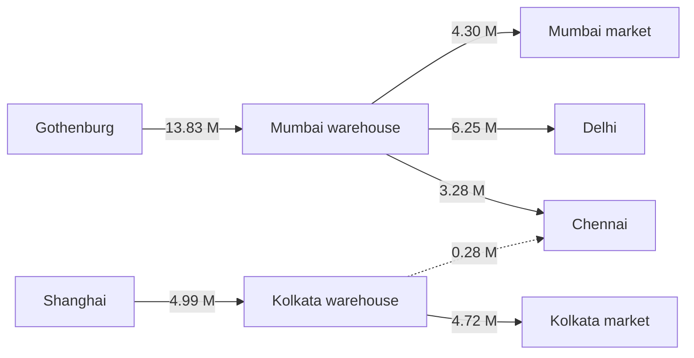
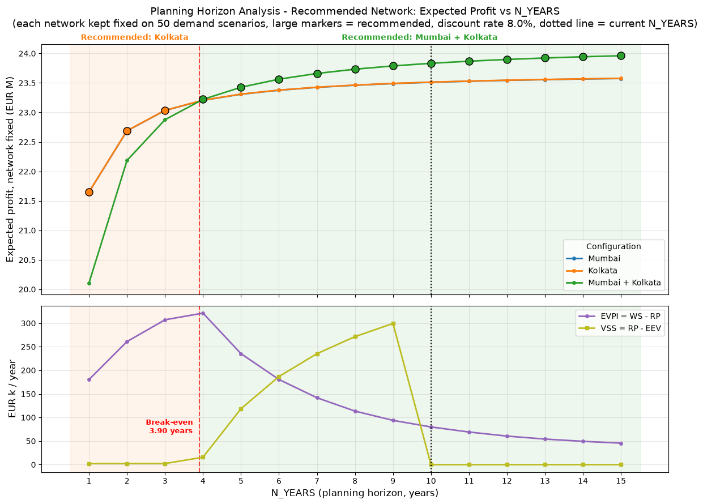
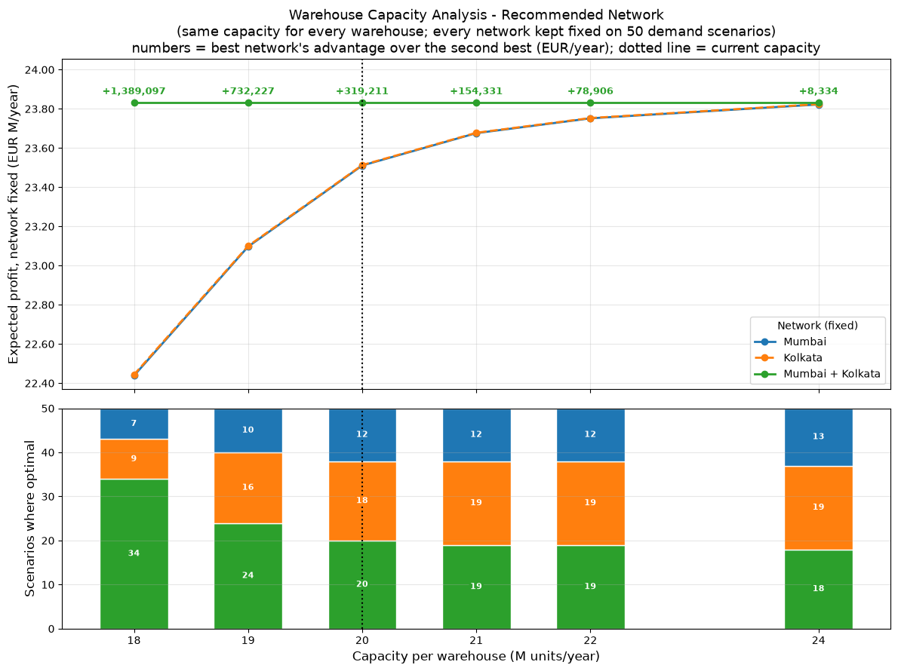
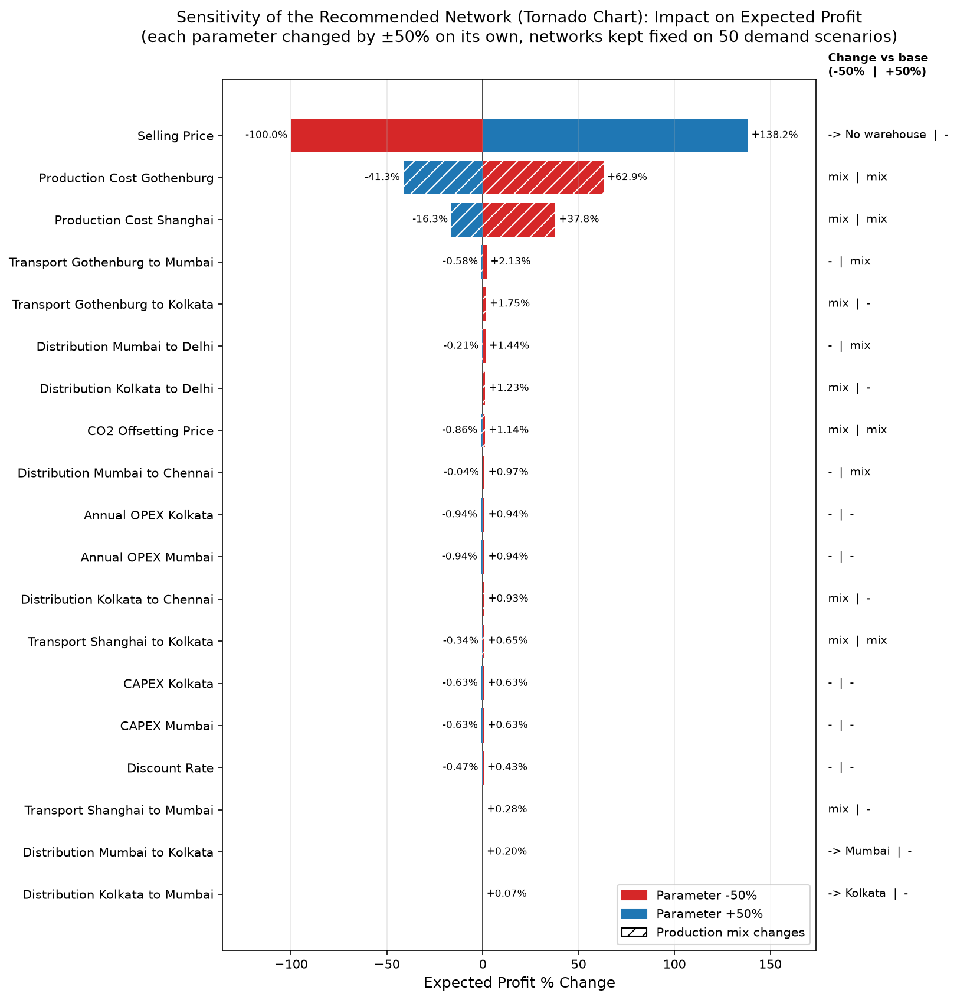
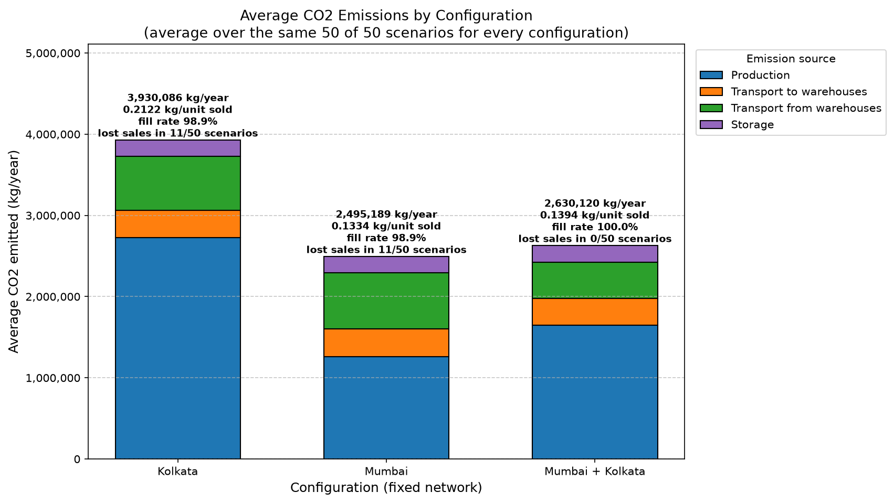
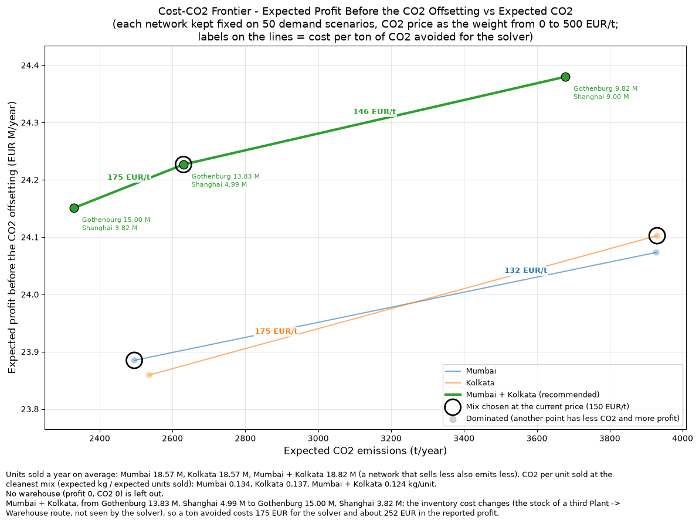

# Results

*Supply Chain Network Design: Simulation and Optimization of a 3-Stage Network* — results obtained with the case data. How the model and the analyses work is explained in the [README](README.md).

**The question.** Two plants, in Gothenburg (Sweden) and Shanghai (China), supply four markets in India (Mumbai, Kolkata, Delhi and Chennai) through regional warehouses. A warehouse can be opened in Mumbai, in Kolkata or in both. When the future demand is uncertain, which warehouses should be opened, and how much should each plant produce and ship to them?

**The answer.** Open **both Mumbai and Kolkata**, with Gothenburg supplying the Mumbai warehouse and Shanghai the Kolkata one: on average 13.83 M and 4.99 M units/year. Each network was kept fixed and evaluated on 50 demand scenarios: Mumbai + Kolkata has the highest expected profit, **23.83 M EUR/year**, about **319,000 EUR/year more** than the best single warehouse. It is also the only network that never loses sales: a single warehouse of 20 M units/year runs out of capacity whenever total demand exceeds it, which happens in 11 scenarios out of 50. The choice holds for any warehouse economic life of at least 3.9 years, and whether the demand of each market varies by 5% or by 40% around its mean (coefficient of variation from 0.05 to 0.40). What is fragile is not the network but its CO2 emissions, which depend on a production mix that sits on a near cost tie.

## Key results at a glance

| Topic | Result | Details |
|---|---|---|
| **Recommended network** | Mumbai + Kolkata: expected profit **23,832,195 EUR/year**, with the network fixed on 50 demand scenarios; no lost sales in any scenario | [§2](#2-recommended-network) · [`decision_summary.xlsx`](Output/decision_summary.xlsx) |
| **Production plan** | Gothenburg → Mumbai warehouse, 13.83 M units/year; Shanghai → Kolkata warehouse, 4.99 M units/year (averages over the 50 scenarios). Gothenburg (capacity 15 M units/year) reaches its capacity only in the highest-demand scenarios | [§2](#2-recommended-network) · [`report_configurations.xlsx`](Output/report_configurations.xlsx), [`production_by_plant.png`](Output/production_by_plant.png) |
| **Advantage** | **+319,211 EUR/year** over Kolkata alone and +321,468 EUR/year over Mumbai alone, about 1.3% of the profit | [§2](#2-recommended-network) · [`decision_summary.xlsx`](Output/decision_summary.xlsx) |
| **Where it comes from** | Mainly from the sales a single warehouse loses in high-demand scenarios (250,007 units/year on average), about 97% of the advantage; the rest from cheaper local distribution to the Kolkata market | [§2](#2-recommended-network), [§3.2](#32-warehouse-capacity-and-demand-variability) · [`report_configurations.xlsx`](Output/report_configurations.xlsx), [`capacity_analysis.xlsx`](sensitivity_analysis/capacity_analysis.xlsx) |
| **Value of the uncertainty** | EVPI 79,903 EUR/year, 0.3% of the profit: knowing the demand in advance would be worth little. VSS 0 EUR/year at the assumed 10-year horizon, because the average demand alone also picks Mumbai + Kolkata; at 9 years ignoring the uncertainty would cost 299,368 EUR/year | [§3.1](#31-planning-horizon-and-value-of-the-uncertainty) · [`n_years_analysis.xlsx`](sensitivity_analysis/n_years_analysis.xlsx) |
| **Planning horizon** | Recommended for any warehouse life of **3.90 years** or more (10 years assumed). A plan based on the average demand alone would need 9.56 years | [§3.1](#31-planning-horizon-and-value-of-the-uncertainty) · [`n_years_analysis.xlsx`](sensitivity_analysis/n_years_analysis.xlsx) |
| **What could change it** | Within ±50% of each parameter, only three: the selling price (−35.6%) and the Mumbai ↔ Kolkata distribution tariffs (−43.6% and −47.6%). The warehouse costs only far beyond that range: OPEX +71%, CAPEX +107%, discount rate 28.3% | [§3.3](#33-prices-and-costs) · [`sensitivity_results.xlsx`](sensitivity_analysis/sensitivity_results.xlsx) |
| **Capacity and demand variability** | Recommended for every warehouse capacity tested (18–24 M units/year per warehouse) and every demand CV (0.05–0.40). The advantage goes from 1,389,097 EUR/year (18 M units/year) to 8,334 EUR/year (24 M units/year), and from 12,916 EUR/year (CV 0.05) to 739,021 EUR/year (CV 0.40) | [§3.2](#32-warehouse-capacity-and-demand-variability) · [`capacity_analysis.xlsx`](sensitivity_analysis/capacity_analysis.xlsx), [`cv_analysis.xlsx`](sensitivity_analysis/cv_analysis.xlsx) |
| **CO2 trade-off** | 2.63 M kg CO2/year. On the cost–CO2 frontier only the production mixes of Mumbai + Kolkata are efficient: CO2 can be cut by 11.4% for 30,686 EUR/year, 0.13% of the profit, but not below 2.33 M kg CO2/year with the current plants | [§4](#4-co2-emissions-and-the-costco2-trade-off) · [`co2_frontier.xlsx`](sensitivity_analysis/co2_frontier.xlsx) |
| **CO2 robustness** | The network choice is robust, its CO2 is not: a 0.05% change in a production cost is enough to move the production mix and raise the expected CO2 by 39.9% | [§4](#4-co2-emissions-and-the-costco2-trade-off) · [`co2_frontier.xlsx`](sensitivity_analysis/co2_frontier.xlsx) |

Unless stated otherwise, all figures are annual, in EUR, and averaged over the 50 demand scenarios with the network kept fixed; every number comes from, or is derived from, the output files linked in each section.

## 1. The case in brief

A single product is made in two plants, Gothenburg (Sweden) and Shanghai (China), shipped by sea to warehouses in India and distributed by road to four markets (Mumbai, Kolkata, Delhi, Chennai). The candidate warehouses are Mumbai and Kolkata; the network diagram, the input data and the method are described in the [README](README.md).

Two features of the data drive most of the results:

- The two plants have the same production cost (2.00 EUR/unit), but Shanghai emits about 18 times more CO2 per unit.
- One warehouse (20 M units/year) only just covers the average demand (19 M units/year), so in high-demand scenarios a single warehouse runs out of capacity.

## 2. Recommended network

| Network (fixed on the 50 scenarios) | Optimal in (scenarios) | Expected profit (EUR/year) | P10 profit (EUR/year) | Scenarios with lost sales | Max regret (EUR/year) |
|---|---|---|---|---|---|
| **Mumbai + Kolkata** | 20 | **23,832,195** | 21,118,626 | 0 | 387,200 |
| Kolkata | 18 | 23,512,985 | 21,220,980 | 11 | 4,417,260 |
| Mumbai | 12 | 23,510,727 | 21,109,387 | 11 | 4,149,658 |

*Optimal in*: scenarios in which the network would be the best choice if that scenario's demand were known in advance. *Max regret*: the largest loss, across the scenarios, compared with the best network for that scenario.

- **Same cost per unit, more units sold.** The three networks cost about 2.234 EUR per unit sold; Mumbai + Kolkata wins because it sells the 250,007 units/year a single warehouse loses.
- **Frequency is not the criterion.** Kolkata is optimal in 18 scenarios and Mumbai in 12, yet their expected profits differ by only 2,257 EUR/year: counting wins says nothing about how much is won or lost.

**It works like insurance.** Compared with Kolkata alone, the second warehouse costs a little in most normal scenarios and pays off heavily when demand peaks:

| Mumbai + Kolkata vs Kolkata alone | Scenarios | Average profit difference (EUR/year) |
|---|---|---|
| Total demand above 20 M units/year | 11 | +1,565,207 (up to +4,417,260) |
| Below 20 M, Mumbai + Kolkata better | 16 | +79,795 |
| Below 20 M, Kolkata better | 23 | −110,150 (at worst −251,318) |
| All scenarios | 50 | **+319,211** |

This is why only the P10, which looks at the low-demand scenarios, prefers Kolkata (by 0.5%), while the expected profit and the maximum regret both choose Mumbai + Kolkata.

**How the recommended network operates** (average flows over the 50 scenarios, units/year):

Each plant supplies one warehouse. Gothenburg has spare capacity in most scenarios, yet the Kolkata warehouse is supplied from Shanghai: once CO2 offsetting is counted, Shanghai → Kolkata is cheaper than Gothenburg → Kolkata by 0.006 EUR/unit. Only when Gothenburg is full (13 of the 50 scenarios) does the Kolkata warehouse of this network also serve part of Chennai (dashed line).

Source: [`decision_summary.xlsx`](Output/decision_summary.xlsx), [`report_configurations.xlsx`](Output/report_configurations.xlsx).

## 3. How robust is the recommendation?

### 3.1 Planning horizon and value of the uncertainty

**Three criteria, three answers.** With a warehouse life between 4 and 9 years, planning on the average demand, counting how often each network is optimal and maximizing the expected profit pick three different networks:

| Warehouse life (years) | Average demand picks | Most often optimal | Highest expected profit | VSS (EUR/year) |
|---|---|---|---|---|
| 3 | Mumbai | Kolkata | Kolkata | 2,257 |
| 4 | Mumbai | Kolkata | **Mumbai + Kolkata** | 15,685 |
| 5 | Mumbai | Kolkata | **Mumbai + Kolkata** | 118,614 |
| 6 | Mumbai | Kolkata | **Mumbai + Kolkata** | 186,896 |
| 7 | Mumbai | Kolkata | **Mumbai + Kolkata** | 235,382 |
| 8 | Mumbai | Kolkata | **Mumbai + Kolkata** | 271,498 |
| 9 | Mumbai | Kolkata | **Mumbai + Kolkata** | 299,368 |
| 10 (assumed) | Mumbai + Kolkata | Mumbai + Kolkata | Mumbai + Kolkata | 0 |

The average demand never exceeds one warehouse's capacity, so it misses the lost sales and needs 9.56 years before choosing two warehouses. Counting how often each network is optimal treats a win of 1 EUR like a win of 4 M EUR, so it ignores by how much a network wins or loses. Only the expected profit weighs both, and recommends Mumbai + Kolkata from **3.90 years**. VSS is what planning on the average demand would lose.

- Knowing the demand in advance (EVPI) is worth most around the break-even, up to 321,351 EUR/year at 4 years, and only 45,559 EUR/year at 15 years.

Source: [`n_years_analysis.xlsx`](sensitivity_analysis/n_years_analysis.xlsx) (sheets `Expected_Profit`, `Monte_Carlo`, `Tipping_Points`).

### 3.2 Warehouse capacity and demand variability

- The flat green line is Mumbai + Kolkata, which never runs out of capacity. The single-warehouse networks catch up as capacity grows, but even at 24 M units/year they stay 8,334 EUR/year behind.
- Demand variability also sets from which horizon the choice holds: the break-even goes from 9.39 years with a coefficient of variation of 0.05 to 2.18 years with 0.40 (3.90 years at the assumed 0.2).

Source: [`capacity_analysis.xlsx`](sensitivity_analysis/capacity_analysis.xlsx), [`cv_analysis.xlsx`](sensitivity_analysis/cv_analysis.xlsx).

### 3.3 Prices and costs

- The expected profit depends almost only on the selling price and the production costs: at ±50%, −100% / +138% for the price, +63% / −41% for Gothenburg, +38% / −16% for Shanghai. Every other parameter moves it by less than 2.2%.
- A long bar does not mean a fragile choice. With a production cost 50% higher, Mumbai + Kolkata stays the best network, but its advantage falls from 319,211 to 65,105 EUR/year (Gothenburg) or 40,775 EUR/year (Shanghai). The tariffs between Mumbai and Kolkata, almost invisible in the tornado, are the ones that can change it.

Source: [`sensitivity_results.xlsx`](sensitivity_analysis/sensitivity_results.xlsx) (`Summary` and one sheet per relevant parameter).

## 4. CO2 emissions and the cost–CO2 trade-off

- At the current CO2 price, Mumbai alone emits slightly less than Mumbai + Kolkata (2.50 against 2.63 M kg/year), because it has already switched to the cleaner production mix; Kolkata alone emits the most (3.93 M kg/year). Production is the largest source in every network, 51–69% of the total.

- On the frontier only the three production mixes of Mumbai + Kolkata are efficient. The production mix switches at 146.09 and 174.92 EUR per ton of CO2, and with the current plants emissions cannot go below 2.33 M kg/year.
- At its cleanest mix Mumbai + Kolkata is also the best network per unit sold (0.124 against 0.134 kg/unit for Mumbai). To emit less it pays to change the production mix, not the network.
- The local thresholds of each parameter are in `Mix_Thresholds`: for example, Gothenburg production cost +0.05% or the distribution Mumbai → Delhi +0.93%.

Source: [`co2_emissions.xlsx`](Output/co2_emissions.xlsx), [`co2_frontier.xlsx`](sensitivity_analysis/co2_frontier.xlsx).

## 5. Limitations

Relaxing these assumptions would not all push in the same direction: demand growth, positively correlated markets or a penalty on lost sales would strengthen Mumbai + Kolkata, while economies of scale, safety stock, construction time or a risk-averse criterion (the P10 already prefers Kolkata) would weaken it.

- **Static year:** demand, prices and costs are constant over the planning horizon, the warehouses have no residual value after 10 years, and there is no construction or ramp-up time.
- **Demand:** independent normal demand per market with the same variability, and one sample of 50 scenarios. With 19 other samples Mumbai + Kolkata is always the best network, ahead by 278,502 to 755,322 EUR/year.
- **Commercial side:** one selling price for all markets, a lost sale costs only its margin (no penalty), and there are no economies of scale.
- **Inventory:** only cycle stock, kept out of the optimization; no safety stock and no pipeline stock (lead times are not modelled).
- **CO2:** road emissions in India are estimated from the transport spend; CO2 is an offsetting cost at a constant price, with no emission cap.
- **Analyses:** a risk-neutral choice among three networks; the sensitivity moves one parameter at a time by the same ±50%; plant capacity and emission factors are not analysed.

## 6. Conclusions

- **Open both warehouses.** It is a decision about capacity under uncertain demand more than about logistics cost: its value comes mainly from the sales a single warehouse would lose when demand peaks.
- **Plan on scenarios, not on the average demand.** At 10 years the average demand picks the same network, but by just 9,204 EUR/year; with a warehouse life between 4 and 9 years it would pick the wrong one ([§3.1](#31-planning-horizon-and-value-of-the-uncertainty)).
- **Two things to monitor:** the distribution tariff between Mumbai and Kolkata (below about 0.09 EUR/unit, against 0.16 today, a single warehouse becomes better) and the production mix, whose CO2 can jump by 40% with a small cost change. A small incentive or an emission cap would secure the cleaner mix at almost no cost.

## 7. Next steps

- **Two-stage stochastic program in a single model** (planned as a separate project): one network common to all scenarios and flows per scenario. It scales to many candidate sites and allows risk measures (e.g. CVaR), service-level constraints and an estimate of the error due to the number of scenarios.
- **Richer demand:** correlation between markets and growth over time.
- **Inventory and service:** safety stock and service-level targets, lead times and pipeline stock, inventory cost inside the optimization.
- **CO2:** an emission cap alongside the offsetting price, and sensitivity on the emission factors.
- **Broader sensitivity:** several parameters changed together, and the plant capacity.
